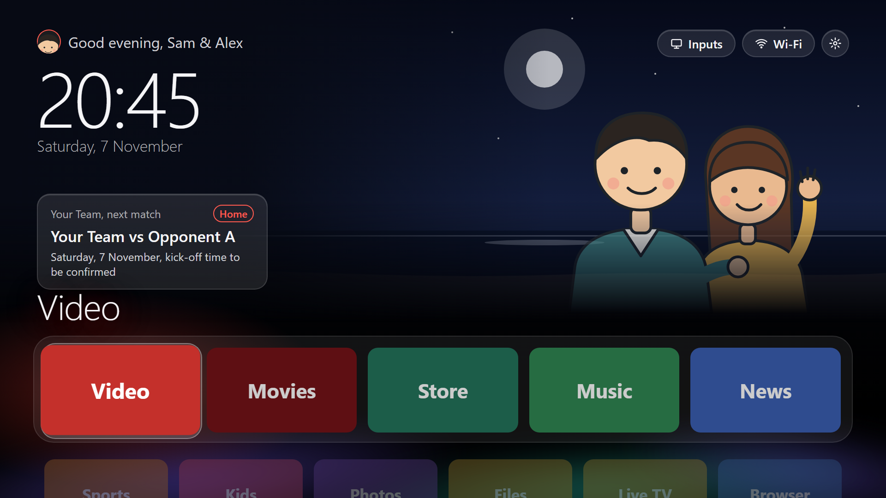
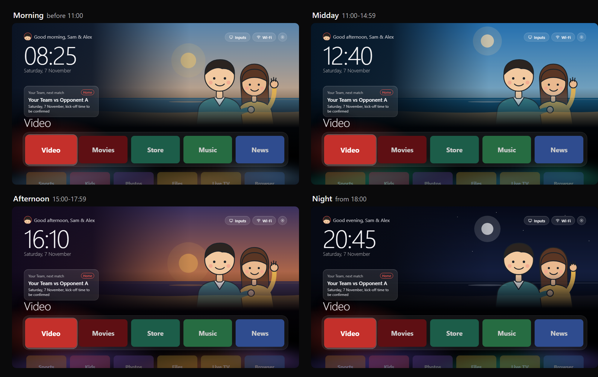
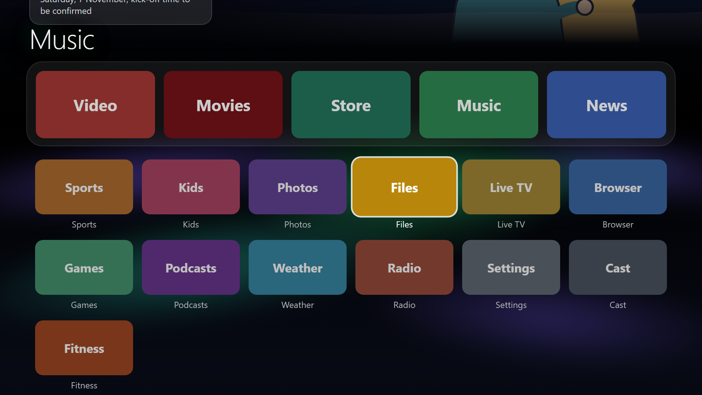
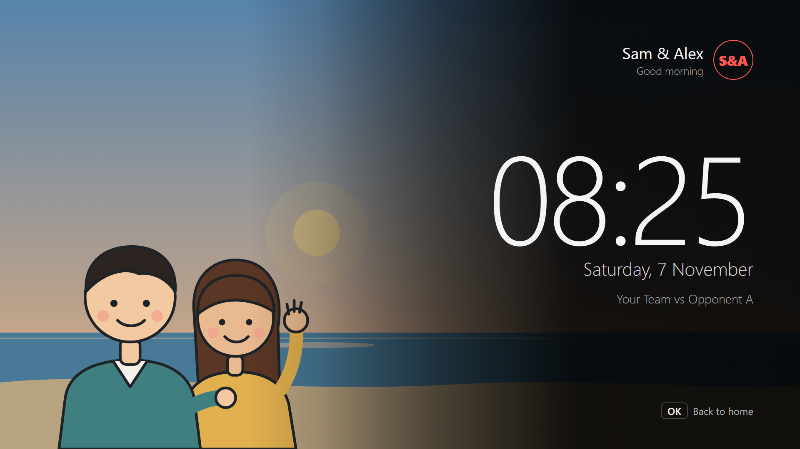
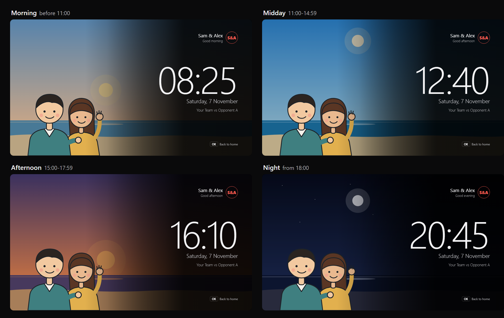

# clean and speed up my TV

A calm, light home screen for Android TV, and a step-by-step guide an AI coding agent can follow to
debloat a TV safely and install it. Made for a Sharp AQUOS (Android TV 11) that had become slow; works on
most Android TV / Google TV sets with Android 8.0 or newer.

**What you get**

- **Debloat, reversibly**: recommendation rows, partner stubs, demo mode and other background apps are
  disabled (never uninstalled), with an undo file for every change.
- **Home screen** (`launcher/`, about 120 KB, no network, no libraries):
  - black Apple TV style home with a dock of five app banners and one glass highlight that springs between them;
  - the focused app's name in large type and a soft glow in its colour behind the tile;
  - a beach that changes with the time of day (morning, midday, afternoon, night) over an aurora backdrop;
  - your own greeting, monogram, avatar (two poses) and characters, all optional;
  - "All apps" below the dock, dropdowns for Inputs (HDMI), Wi-Fi and Settings, Indonesian and English;
  - an idle screen (screensaver) in the same style.
- About 55 MB of RAM in use on a 1080p TV, after the stock launcher and its helpers are switched off.

## Screenshots

From the public mockup in [docs/mockup/](docs/mockup/) (open `index.html` in a browser), with **example
people** ("Sam & Alex", drawn for this repo). On your TV they are replaced by your own names, avatar and
characters from `config.json` and `assets/custom/` (see [docs/CUSTOMIZE.md](docs/CUSTOMIZE.md)).

### It follows the time of day

The beach (sky, sun or moon, sea, sand), the aurora under it and the greeting change by themselves:
**morning** before 11:00, **midday** 11:00-14:59, **afternoon** 15:00-17:59, **night** from 18:00
(with the moon and stars). Each scene is painted once when the time of day changes, so it costs nothing
while you watch.

### All apps and the idle screen

Press Down on the dock to scroll to every installed app. When the TV is idle, the screensaver shows the
same beach, your characters on the left and a large clock on the right.

| All apps | Idle screen |
|---|---|
|  |  |

To regenerate these pictures on Windows: `powershell -File docs/mockup/export.ps1` (uses the Edge or Chrome
already installed).

## Use it with an AI agent

1. Clone this repo on a computer on the same Wi-Fi as the TV.
2. On the TV: Settings > Device Preferences > About > press OK on "Build" 7 times; Developer options >
   USB debugging (and Network/ADB debugging) on.
3. Open the repo in Claude Code (or another agent with a shell) and paste [PROMPT.md](PROMPT.md).

The agent follows [AGENTS.md](AGENTS.md): design on a mockup first, your images, backup, debloat in small
batches, build, install, verify, and close ADB at the end. It asks before every change on the TV.

## Do it yourself

- Build: JDK 17 + Android SDK 34, then `cd launcher && ./gradlew assembleRelease`.
- Personalise: [docs/CUSTOMIZE.md](docs/CUSTOMIZE.md).
- The design in numbers: [docs/DESIGN.md](docs/DESIGN.md).
- What to disable and what to keep: [docs/DEBLOAT.md](docs/DEBLOAT.md).
- The full procedure: [docs/WORKFLOW.md](docs/WORKFLOW.md).

## Undo

Every disabled app comes back with `adb shell pm enable <package>`. To go back to the stock home:
enable the stock launcher, then `adb uninstall com.cleantv.home`.

## Credits

Safety rules and device knowledge from [cleanyourtv](https://github.com/Gathin23/cleanyourtv) (MIT).
This repo shares no code with it.

## Licence

MIT, see [LICENSE](LICENSE).
